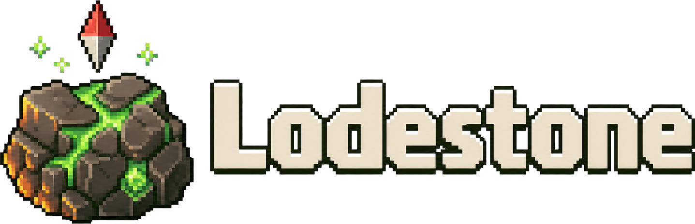
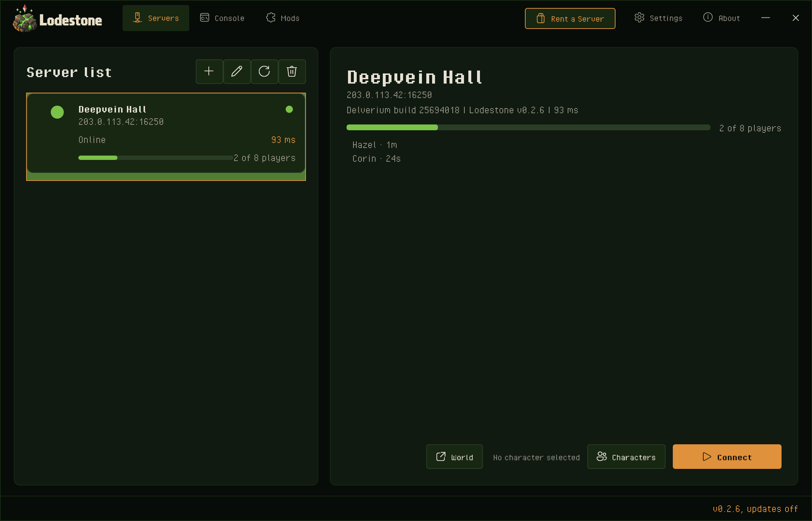
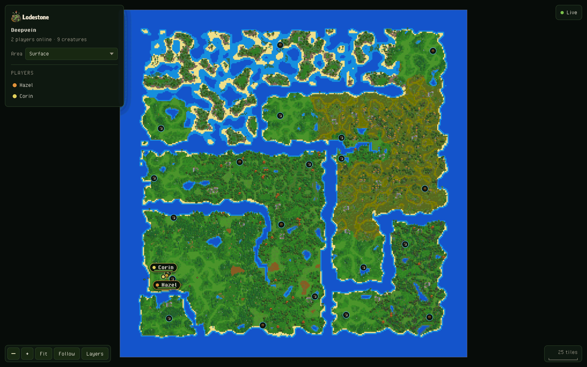
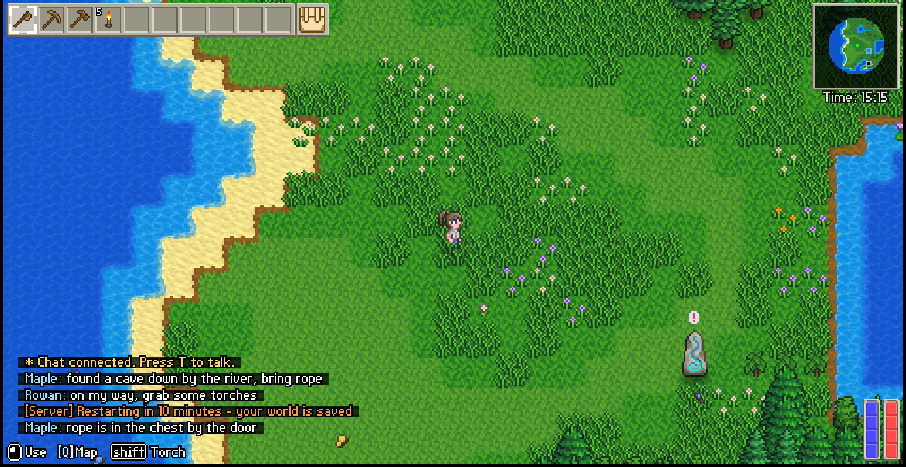
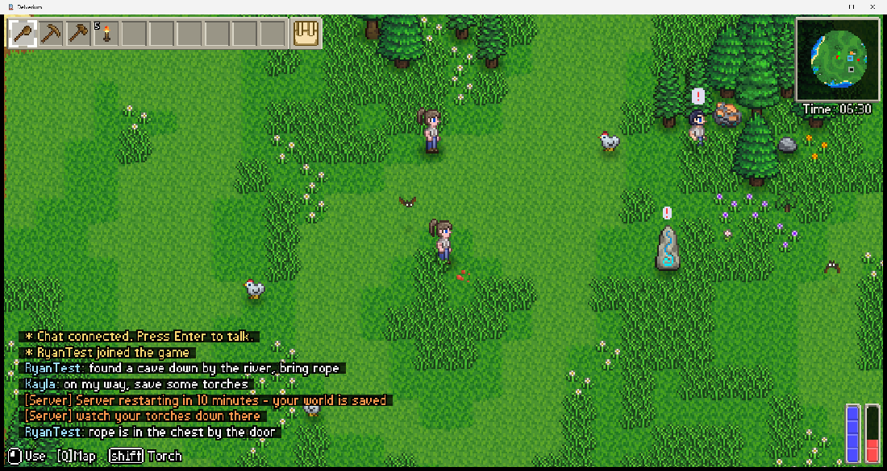
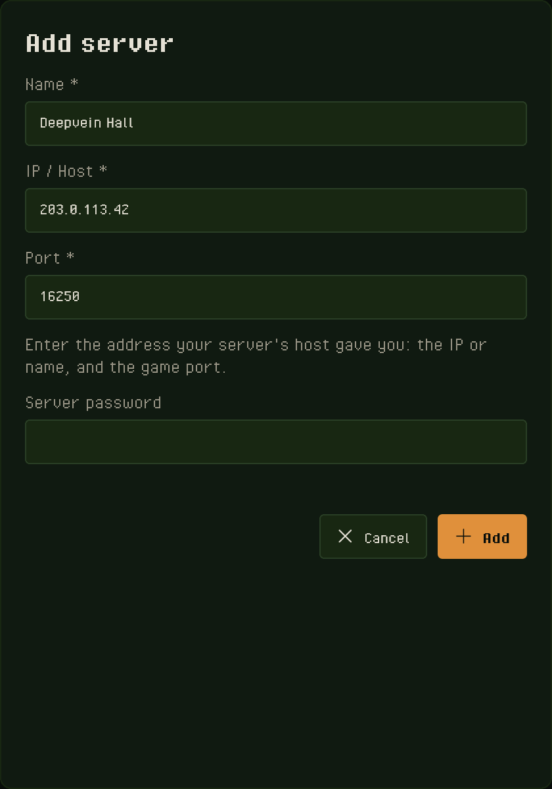
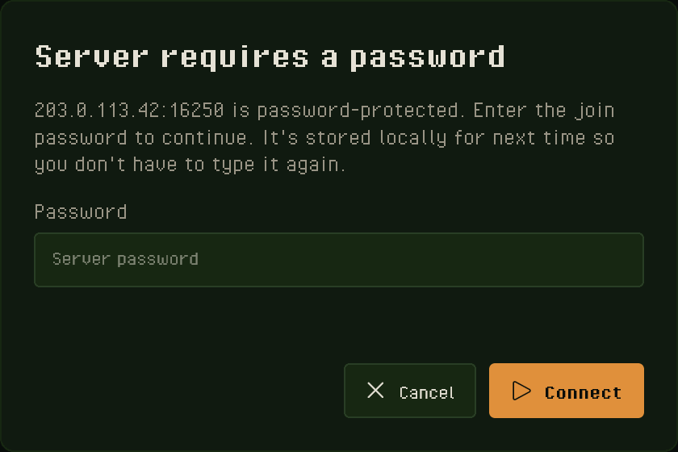
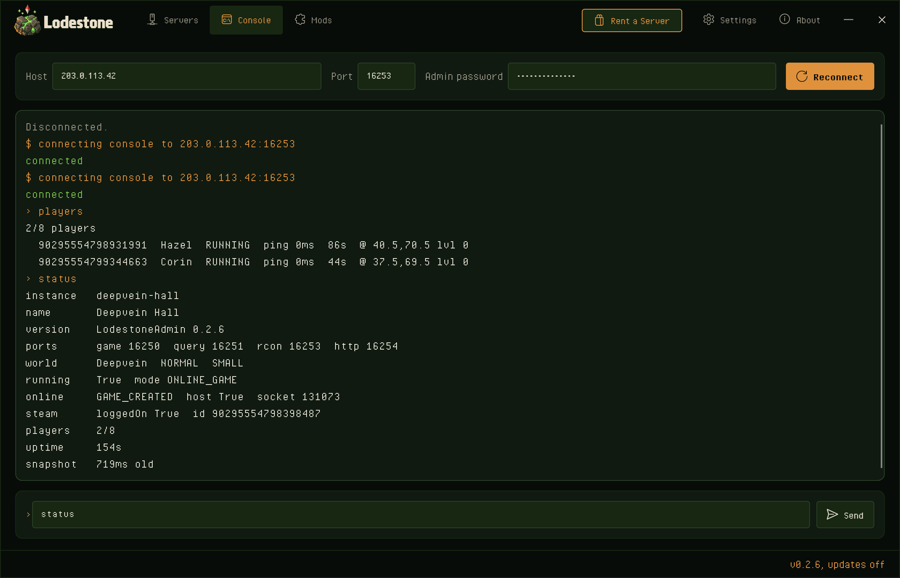
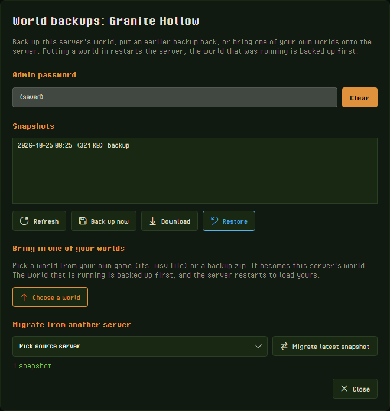

  

  
  
  
  
  

# Lodestone

Delverium has no dedicated server. Its online co-op is a session hosted from one player's copy of the game, and the world only exists while that player has the game open. Lodestone adds a Delverium dedicated server. Players join it by IP with the Lodestone app.

Every player needs the Lodestone app to join.

  

## Features

### 🗺️ Live map
Every Lodestone server has a live map you open in a browser. It shows the world in the game's own art and updates as players mine and build. It marks every player and teleporter, and History plays back how the world changed.

  

### 💬 Text chat
Delverium has no chat, so Lodestone adds one. Press **T** in game to talk. Player messages, join and leave notices, server announcements and restart countdowns all show in one feed, in the game's own font. Admins get chat commands too: teleport a player, set the message of the day, warn everyone before a restart.

  

### 👥 Up to 8 players
Delverium's Steam page says up to 8 players. The server doesn't use one of them, so all 8 are for players. The most we've seen on one server at once is 5.

  

### 🧭 Join by IP
Add the server's IP and port in the app, pick a character and click Connect. Lodestone starts Delverium and joins the server for you. Before you connect, the app shows whether the server is up, who's online and your ping.

  

### 🔒 Password protection
Set a join password on the server and only players who enter it in the app get in. The app asks once and keeps it on that PC for next time.

  

### 🖥️ Server console
Enter the server's admin password in the Console tab to see who's online, kick, ban, save, restart and send a message to the in-game chat.

  

### 💾 World backups
The World backups window backs up the running world, downloads a backup and restores one after asking first. Upload a save from your own single-player game and the server backs up its running world, then loads yours on its next start. Like the Console tab, it needs the server's admin password.

  

## Install

### Rent a server
[SurvivalServers.com](https://www.survivalservers.com/services/game_servers/delverium/?utm_source=github&utm_medium=readme_install&utm_campaign=lodestone) runs Delverium servers with LodestoneServer installed. Click **Open in Lodestone** in Command Center to add your server to the app.

### Players
1. Download `LodestoneSetup-latest.exe` from the [latest release](https://github.com/HumanGenome/Lodestone/releases/latest/download/LodestoneSetup-latest.exe).
2. Run it. If Windows shows "Windows protected your PC", choose More info, then Run anyway. The app updates itself after that.
3. Open Lodestone and add the server's IP and port.
4. Pick a character and click Connect.

If Windows says Smart App Control blocked the installer, wait a day or two for Windows to recognize the new version and run it again, or turn Smart App Control off in Windows Security under App & browser control.

If the app closes to update and then won't open, download `LodestoneSetup-latest.exe` from the [latest release](https://github.com/HumanGenome/Lodestone/releases/latest) and run it again.

### Host your own
You need a Windows PC and Delverium's game files from your own Steam copy. The server download doesn't include the game. Setup, ports, RCON, the whitelist and the chat commands are in [LodestoneServer](https://github.com/HumanGenome/LodestoneServer).

## Releases

This repo has the app's installer, `LodestoneSetup-<version>.exe` (also as `LodestoneSetup-latest.exe`), and its release notes. The server download is on the [LodestoneServer release page](https://github.com/HumanGenome/LodestoneServer/releases/latest), and [LodestoneServer's CHANGELOG.md](https://github.com/HumanGenome/LodestoneServer/blob/main/CHANGELOG.md) covers the server.

## Source

- **Lodestone** (this repo): the app players install, the downloads and the documentation.
- **[LodestoneServer](https://github.com/HumanGenome/LodestoneServer)**: the server download that runs beside Delverium's game files.

## FAQ

### How many players can join?
Up to 8, the number Sagestone Games gives on Delverium's [Steam page](https://store.steampowered.com/app/2710040/). The server doesn't use one of them. The most we've seen on one server at once is 5.

### Does it change my game?
It adds `winhttp.dll`, `doorstop_config.ini` and the `BepInEx` and `dotnet` folders next to `Delverium.exe`. Steam updates the game as normal. Delete those four to remove it. Starting Delverium from Steam after playing on a Lodestone server runs the normal game, and your single-player and ordinary co-op games are untouched.

### Where is my character saved?
On your PC, where Delverium keeps it, so you can bring any of your characters to any Lodestone server. The server holds the world.

### Will my server show up inside Delverium?
Delverium's Online menu lists your Steam friends. On a PC with Lodestone installed, the server you last connected to appears in that menu as well.

### Can a world move between servers?
Yes. Download a backup in the app's World backups window, then pick that zip with **Choose a world** on the other server. The world save is also a plain file on the server: stop both servers and copy it across.

### Why does Windows warn about the installer?
Windows shows "Windows protected your PC" for new apps it doesn't know yet. Choose More info, then Run anyway. You can check the file against the release's `checksums.txt`.

## Contributing

See [CONTRIBUTING.md](CONTRIBUTING.md). Security issues go through [private reporting](.github/SECURITY.md), never a public issue.

Bugs: [open an issue](https://github.com/HumanGenome/Lodestone/issues).

## Community note

Lodestone is an independent community project. It isn't affiliated with, endorsed by, or supported by Sagestone Games. Delverium is their game: [buy it on Steam](https://store.steampowered.com/app/2710040/).

## License

MIT, see [LICENSE](LICENSE).

## Credits

- [BepInEx](https://github.com/BepInEx/BepInEx), the Unity modding framework Lodestone runs on, on the server and in your game
- [Avalonia](https://avaloniaui.net/), the .NET UI framework used by the Lodestone app
- [Pixel Operator](https://www.dafont.com/pixel-operator.font) (CC0), the typeface in Lodestone's brand art
