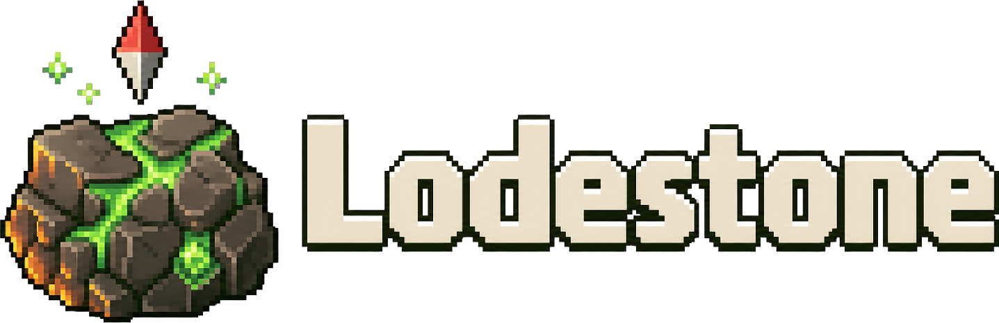
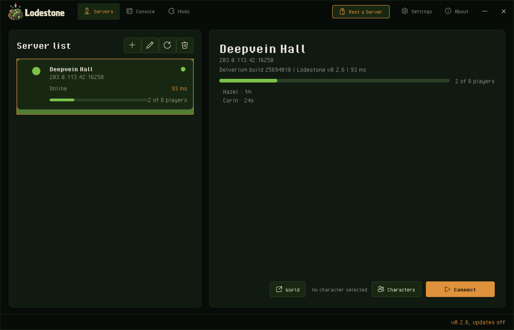
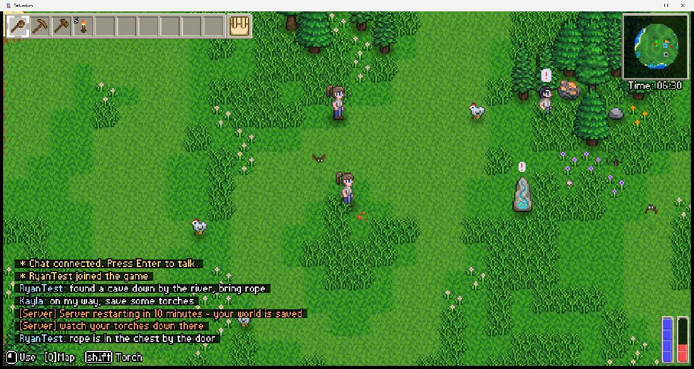
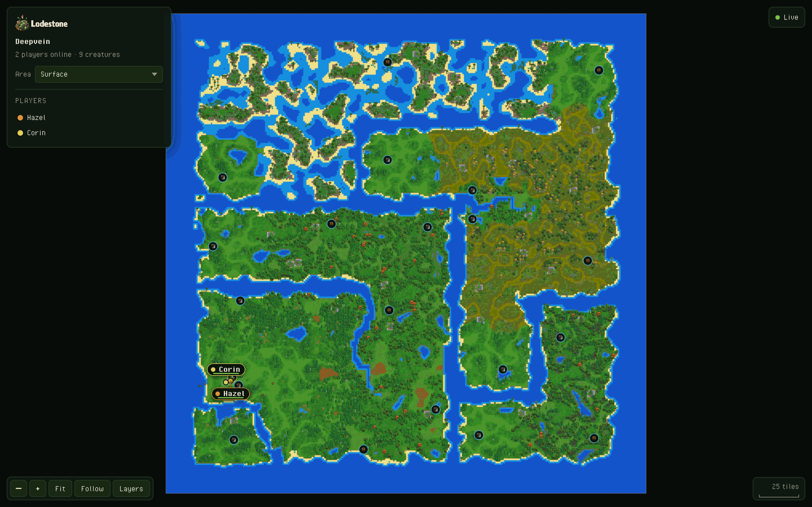
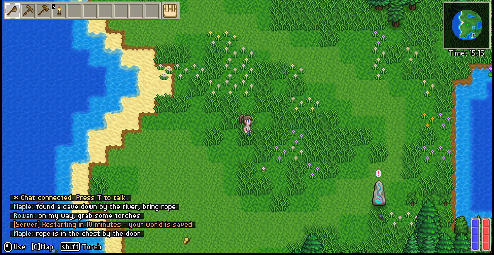
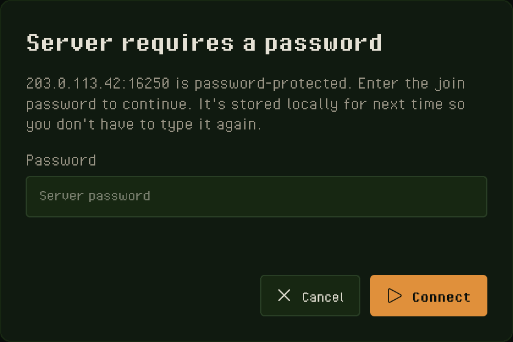
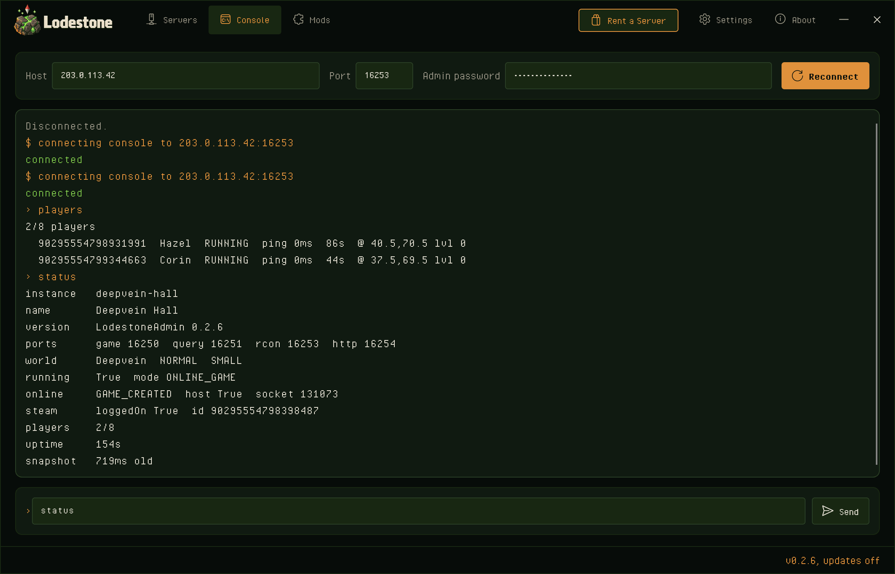
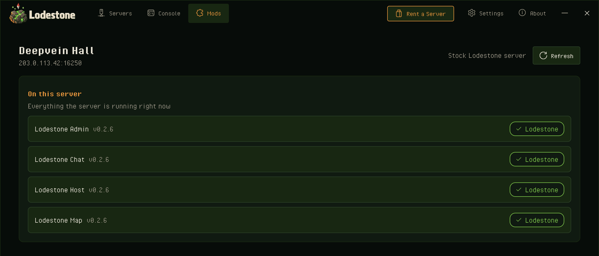

  

  
  
  
  
  

# Lodestone

Delverium has no dedicated server. Its online co-op is a session hosted from one player's copy of the game, and the world only exists while that player has the game open. Lodestone adds a Delverium dedicated server: [LodestoneServer](https://github.com/HumanGenome/LodestoneServer) runs the game headless on a Windows machine with a public IP and port, and the Lodestone app connects players to it by address.

Every player must install Lodestone to join a Lodestone server. Stock Delverium cannot connect to a Lodestone server directly.

## Features

### 🧭 Join by address
Add the server's `ip:port` in the app, pick a character and click Connect. The app puts the connection files next to your game, starts Delverium and joins the server. The app shows whether the server is up, who is online and your ping before you connect.

  

### 🌙 Always running
The server creates the world and saves it. It keeps running after the last player logs off, so your group can play at different times on the same world.

  

### 🗺️ Live world map
Every Lodestone server has a map page you open in a browser. It draws the world from the game's own ground art, one level at a time, and redraws it as players mine and build. It marks each connected player and every teleporter, and keeps a timelapse of how the world changed.

  

### 💬 In-game chat
Delverium has no chat, so Lodestone adds one. Press **T** in game to talk. Player messages, join and leave notices, server announcements and restart countdowns all land in one feed, drawn by the game's own UI in the game's own font. Admins get chat commands too: teleport a player, set the message of the day, warn everyone before a restart.

  

### 🔒 Password protection
Set a join password on the server and only players who enter it in the app get in. The app asks once and keeps it on that PC for next time.

  

### 🖥️ Admin console
Enter the server's admin password in the Console tab and the app talks to the server's admin port: who is online, kick, ban, save, restart, and a broadcast into the in-game chat.

  

### 🧩 Mods
The Mods tab lists every plugin the selected server runs, with its version, and marks Lodestone's own parts apart from other server mods.

  

## Install

### Rent a server
[SurvivalServers.com Delverium server hosting](https://www.survivalservers.com/services/game_servers/delverium/?utm_source=github&utm_medium=readme_install&utm_campaign=lodestone) comes with Lodestone installed and kept up to date, the ports open, and a control panel with the live map, the console and one-click restores.

### Players
1. Download `LodestoneSetup-latest.exe` from the [latest release](https://github.com/HumanGenome/Lodestone/releases/latest/download/LodestoneSetup-latest.exe).
2. Run it. One install per PC. The app updates itself from then on.
3. Open Lodestone, add the server address, pick a character, click Connect.

### Self-hosted servers
Requirements, ports, setup, the live map page, the admin API and the chat commands are in [LodestoneServer](https://github.com/HumanGenome/LodestoneServer). For hosts the server also has Source RCON, a signed HTTP API, a live roster file for panels and bots, a ban list and an allow list that survive restarts, a Source A2S answer on the port above the gameplay port, and a boot report that says in plain words why a server did not start. You need a Windows machine and a copy of Delverium's game files on it from your own Steam copy; the server package ships no part of the game.

## Releases

This repo publishes the player side: `LodestoneSetup-<version>.exe`, a `LodestoneSetup-latest.exe` alias, and the release notes. The server package is on the [LodestoneServer release page](https://github.com/HumanGenome/LodestoneServer/releases/latest), and the changelog for both sides is [LodestoneServer's CHANGELOG.md](https://github.com/HumanGenome/LodestoneServer/blob/main/CHANGELOG.md).

## Source

- **Lodestone** (this repo): the app players install, the downloads and the documentation.
- **[LodestoneServer](https://github.com/HumanGenome/LodestoneServer)**: the server package hosts run next to Delverium's game files.

## FAQ

### Does everyone need the app?
Yes. The game cannot reach a Lodestone server without it. It installs once per PC, and normal Delverium co-op still works whenever you want it.

### How many players can join?
Up to eight, the number Sagestone Games gives on Delverium's [Steam page](https://store.steampowered.com/app/2710040/), and the server takes no seat. The most we have seen on one server at once is five. Characters are made in the game as always and stay on your PC; you pick which one to bring.

### Does it change my game?
It adds `winhttp.dll` and a `BepInEx` folder next to `Delverium.exe`. Steam updates the game as normal. Delete those two to remove it. Starting Delverium from Steam after a Lodestone session runs the normal game, and your single-player and ordinary co-op games are untouched.

### Where is my character saved?
On your PC, where Delverium keeps it. The server holds the world.

### Will my server show up inside Delverium?
Delverium's Online menu lists your Steam friends. On a PC with Lodestone installed, the server you last connected to appears in that menu as well.

### Can a world move between servers?
Yes. The world save is a plain file on the server: stop both servers and copy it across.

### Is this official?
No. Lodestone is an independent project. Sagestone Games does not ship dedicated servers for Delverium.

### Something broke
[Open an issue](https://github.com/HumanGenome/Lodestone/issues). If you rent a server, your host handles billing and control panel questions.

## Contributing

See [CONTRIBUTING.md](CONTRIBUTING.md). Security issues go through [private reporting](.github/SECURITY.md), never a public issue.

## Community note

Lodestone is an independent community project. It is not affiliated with, endorsed by, or supported by Sagestone Games. Delverium is their game: [buy it on Steam](https://store.steampowered.com/app/2710040/).

## License

MIT, see [LICENSE](LICENSE).

## Credits

- [BepInEx](https://github.com/BepInEx/BepInEx), the Unity modding framework the server side runs on
- [Avalonia](https://avaloniaui.net/), the .NET UI framework used by the Lodestone app
- [Pixel Operator](https://www.dafont.com/pixel-operator.font) (CC0), the typeface in Lodestone's brand art
